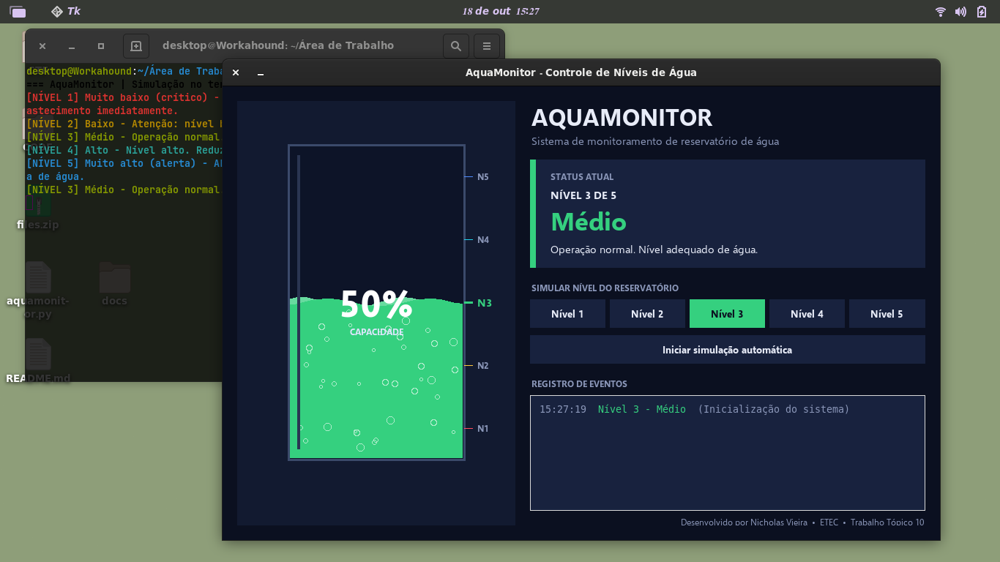

<div align="center">

# 💧 AquaMonitor

### Controle de Níveis de Água

Sistema de monitoramento de reservatório com **interface gráfica animada**, alertas coloridos por nível e saída colorida no terminal com **colorama**.


</div>

---

## 📸 Preview



> Reservatório com água animada (ondas e bolhas), cartão de status, seletor de níveis, simulação automática e registro de eventos.

---

## 🎯 Sobre o projeto

Atividade **Agenda 11 – DSI** da ETEC. O sistema simula um ambiente real de monitoramento de um reservatório com cinco níveis, indo do mais baixo ao máximo. Cada nível possui situação, mensagem de alerta e cor própria.

| Nível | Situação | Cor |
|:-----:|----------|:---:|
| 1 | Muito baixo (crítico) | 🔴 Vermelho |
| 2 | Baixo | 🟡 Amarelo |
| 3 | Médio | 🟢 Verde |
| 4 | Alto | 🔵 Ciano |
| 5 | Muito alto (alerta) | 🟦 Azul |

---

## ✅ Requisitos da atividade atendidos

| Requisito | Onde está no código |
|-----------|---------------------|
| Lista para armazenar níveis e mensagens | `NIVEIS` |
| Importar e usar a biblioteca **colorama** | `from colorama import Fore, Style, init` |
| Função que define a cor conforme o nível | `definir_cor(nivel)` |
| Exibir a situação atual com a cor correspondente | Interface gráfica + `exibir_terminal(nivel)` |
| Restaurar o estilo padrão do terminal | `Style.RESET_ALL` |
| Simulação com valores definidos no código | Seletor manual e modo automático |

---

## ✨ Funcionalidades

- 🌊 Reservatório animado com ondas, bolhas e transição suave de cor
- 🚨 Níveis críticos (1 e 5) com indicador pulsante
- 🎛️ Simulação manual por nível ou **modo automático**
- 🧾 Registro de eventos com horário e cor do nível
- 🖥️ Saída colorida no terminal a cada mudança de nível
- 📦 Projeto em um único arquivo `.py`, sem instalar nada além do colorama (opcional)

---

## 🚀 Como executar

```bash
# 1. Clone o repositório
git clone https://github.com/Yunoratsu/aquamonitor.git
cd SEU-REPOSITORIO

# 2. (Opcional) instale o colorama para as cores no terminal
pip install colorama

# 3. Execute
python Nicholas_Vieira_Ag11_DSI.py
```

> O `tkinter` já acompanha o Python no Windows e no macOS. No Linux (Debian/Ubuntu): `sudo apt install python3-tk`.

### 📦 Gerar um executável (.exe)

```bash
pip install pyinstaller
pyinstaller --onefile --windowed --name AquaMonitor aquamonitor.py
```

O executável será criado na pasta `dist/`.

---

## 🧠 Conceitos aplicados

- Programação estruturada (listas, funções, laços e condicionais)
- Uso de bibliotecas externas (`colorama`) e da biblioteca padrão (`tkinter`, `math`, `random`, `datetime`)
- Organização e legibilidade do código com documentação
- Versionamento com Git/GitHub

**Competência 4:** elaborar sistemas aplicando princípios e paradigmas de programação.
**Habilidades:** 4.1 Codificar programas com programação estruturada · 4.2 Depurar e versionar programas.

---

## 👨‍💻 Autoria

**Nicholas Vieira**
